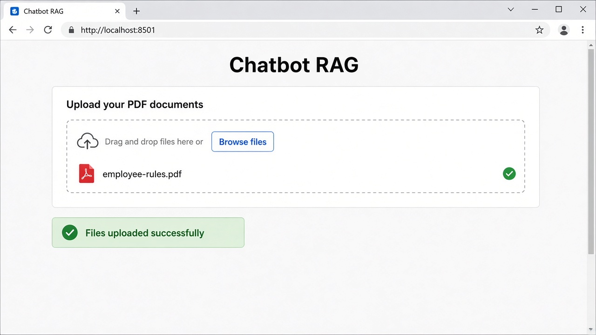
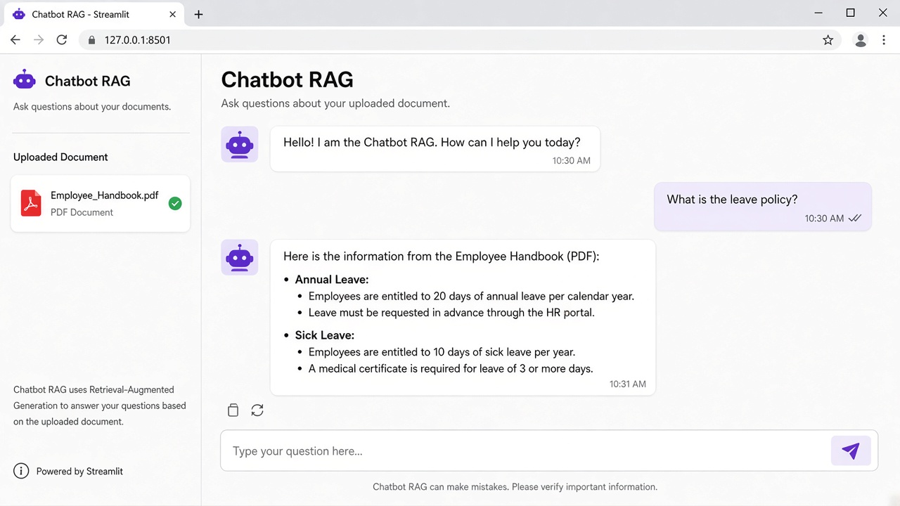
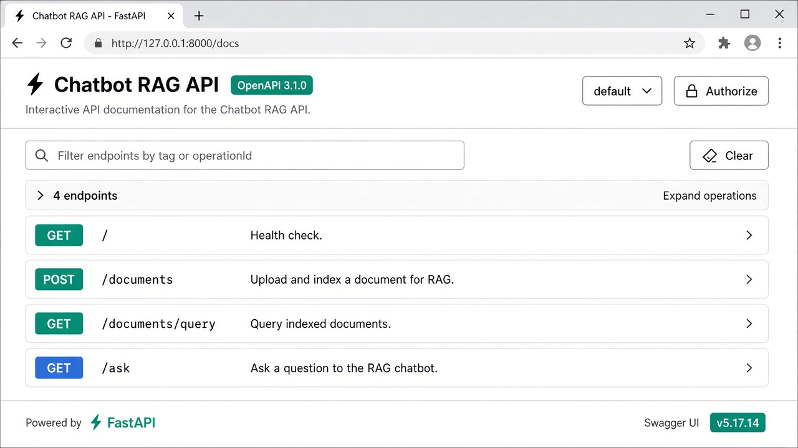

# Chatbot RAG

A full-stack **Retrieval-Augmented Generation (RAG)** chatbot that answers questions from uploaded PDF documents.

Upload PDFs → store embeddings in Chroma → ask questions → get answers grounded in your docs.


**Repo:** [github.com/mohithrangineni-de/chatbot-rag](https://github.com/mohithrangineni-de/chatbot-rag)

## Features

- Upload one or more PDF documents
- Local vector search with **Chroma**
- Question answering with **OpenAI** (`gpt-4o-mini` + `text-embedding-3-large`)
- REST API with **FastAPI** (auto docs at `/docs`)
- Simple chat UI with **Streamlit**

## Demo

### 1. Upload a PDF



### 2. Ask a question



### 3. Explore the API docs



A sample PDF is included at [`examples/employee-rules.pdf`](examples/employee-rules.pdf) so you can try the flow quickly.

## Architecture

```
Streamlit (app.py)  →  FastAPI (api.py)  →  chatbot.py
                                              ├─ PyPDF parse
                                              ├─ Chroma vector store (./data)
                                              └─ OpenAI embeddings + LLM
```

| File | Role |
|------|------|
| `chatbot.py` | Core RAG logic (parse, store, retrieve, ask) |
| `api.py` | FastAPI endpoints |
| `app.py` | Streamlit web UI |
| `requirements.txt` | Python dependencies |
| `.env` | Secrets (not committed) |

## Prerequisites

- Python 3.11+
- An [OpenAI API key](https://platform.openai.com/api-keys) with available credits

## Quick start

### 1. Clone the repo

```bash
git clone https://github.com/mohithrangineni-de/chatbot-rag.git
cd chatbot-rag
```

### 2. Create a virtual environment

```bash
python -m venv venv
source venv/bin/activate   # Windows: venv\Scripts\activate
```

### 3. Install dependencies

```bash
pip install -r requirements.txt
```

### 4. Configure environment variables

```bash
cp .env.example .env
```

Edit `.env` and add your key:

```env
OPENAI_API_KEY=sk-your-key-here
```

### 5. Run the API (terminal 1)

```bash
fastapi dev api.py
```

API: [http://127.0.0.1:8000](http://127.0.0.1:8000)  
Interactive docs: [http://127.0.0.1:8000/docs](http://127.0.0.1:8000/docs)

### 6. Run the UI (terminal 2)

```bash
streamlit run app.py
```

UI: [http://localhost:8501](http://localhost:8501)

## How to use

1. Open the Streamlit app
2. Upload a PDF (try `examples/employee-rules.pdf`)
3. Wait for the success message
4. Ask a question related to the PDF content, for example:
   - "What are the office hours?"
   - "How many annual leave days do employees get?"

## API endpoints

| Method | Path | Description |
|--------|------|-------------|
| `GET` | `/` | Health check |
| `POST` | `/documents` | Upload PDF files |
| `GET` | `/documents/{query}` | Search similar document chunks |
| `GET` | `/ask?query=...` | Ask a question |

## Project structure

```text
chatbot-rag/
├── data/                      # Local Chroma DB (gitignored)
├── examples/
│   └── employee-rules.pdf     # Sample PDF for testing
├── images/                    # Demo screenshots
├── api.py                     # FastAPI server
├── app.py                     # Streamlit UI
├── chatbot.py                 # RAG core
├── requirements.txt
├── .env.example
├── .gitignore
├── LICENSE
└── README.md
```

## Learning notes

This project is a hands-on intro to RAG:

1. **Parse** PDFs into text chunks
2. **Embed** chunks into vectors
3. **Retrieve** the most relevant chunks for a question
4. **Generate** an answer with an LLM using that context

## Security

- Never commit `.env` or API keys
- `.gitignore` already excludes `.env`, `venv/`, and `data/`

## License

MIT — feel free to use and learn from this project.
